# Crew Health Companion

A space-themed, offline-first health journal and recreation prototype built with Next.js and React. The fictional Asteria mission console brings together manual readings, trends, wellbeing notes, a guide library, device connections, and David’s **Move the Moon** game.

**Challenge expansion:** Mission health now adds educational assessment and next steps, mission-environment context, action logs, glucose and temperature collection, a guided emergency rehearsal, and an expanded daily routine/body-region view. See [the full challenge alignment audit](docs/CHALLENGE_ALIGNMENT.md) and screenshots 21–24 below.

**Prototype only:** this app does not diagnose conditions, establish that a reading is safe, provide treatment protocols, or monitor emergencies. Use fictional data for demonstrations. Earth Room has been removed from the interface; Move the Moon is the current recreation screen.

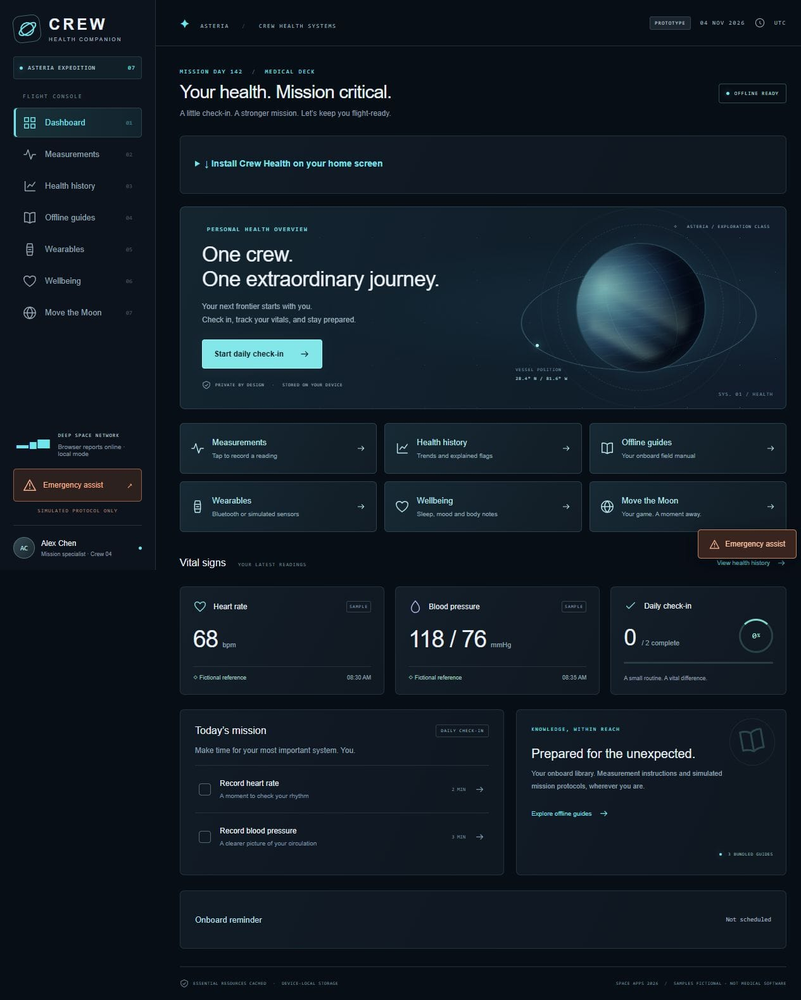

## Start the app

### Requirements

- Node.js **22.18 or newer**; development and tests have also run on Node 24.
- npm, included with Node.js, and Git to clone the repository.
- Internet for dependency installation and the first offline preload.
- A current browser. Core journal features do not require Bluetooth; real sensor connections need browser, OS, and device support.

### Download and install

Open a terminal and run:

```sh
git clone https://github.com/dphan-industries/phanhealth.git
cd phanhealth
npm ci
```

If you already have the project, open a terminal in its folder and run `npm ci`. No API key, account, database server, or `.env.local` file is required for the current interface. The game’s exported files are already bundled; you do not need Expo or Android Studio to run Crew Health.

### Development preview

```sh
npm run dev -- --port 3001
```

Open [http://127.0.0.1:3001](http://127.0.0.1:3001). Changes update during development. This separate port avoids a production service worker serving older cached files while you edit. Use the production workflow below to test offline behaviour.

### Production and offline preview

```sh
npm run build
npm run start -- --port 3000
```

Open [http://127.0.0.1:3000](http://127.0.0.1:3000). Keep the app open and connected until **OFFLINE READY** appears. It verifies both the required cached files and local database availability. The first preload includes roughly 27 MB of game resources before HTTP compression, so give it time.

Press **Ctrl+C** in the terminal to stop either preview. To start again, rerun the corresponding start command. Rebuild after changing production source files.

### Useful commands

| Command | Purpose |
| --- | --- |
| `npm ci` | Install the dependency versions in `package-lock.json`. |
| `npm run dev -- --port 3001` | Run the development preview. |
| `npm run build` | Compile and type-check the production application. |
| `npm run start -- --port 3000` | Serve an existing production build. |
| `npm run lint` | Run ESLint. |
| `npm test` | Run the 24 current automated tests. |
| `npx tsc --noEmit` | Run TypeScript checks without emitting files. |

If port 3000 is occupied, stop the other server or choose another port. Browser data belongs to an origin: `localhost`, `127.0.0.1`, and different ports have separate storage and separate offline preparation. On Windows, if PowerShell blocks `npm.ps1`, use `npm.cmd` for the same commands or run them in Command Prompt.

## Screen-by-screen walkthrough

All screenshots below are real captures of the local app, taken in a separate preview with fictional demo records. They do not show David’s saved health records. Click an image on GitHub to inspect it at full size.

### 1. Dashboard — the mission overview


The left navigation opens Measurements, Health history, Offline guides, Wearables, Wellbeing, and Move the Moon. The dashboard combines quick links with the latest heart-rate and blood-pressure cards, daily check-in progress, and the guide-library shortcut. **SAMPLE** identifies fictional starting readings; those are not measurements from a connected watch. A completed daily check-in means entries were recorded, not that someone passed a health assessment.

The top status distinguishes verified **OFFLINE READY** from a preload or cache warning. The connection indicator reflects the browser’s network report; it does not establish that a remote service is reachable. Mission day, vessel location, crew identity, and spacecraft artwork are fictional presentation elements, not live spacecraft telemetry. Emergency assist opens the training workflow described below.

### 2. Heart-rate entry — record a monitor’s displayed value

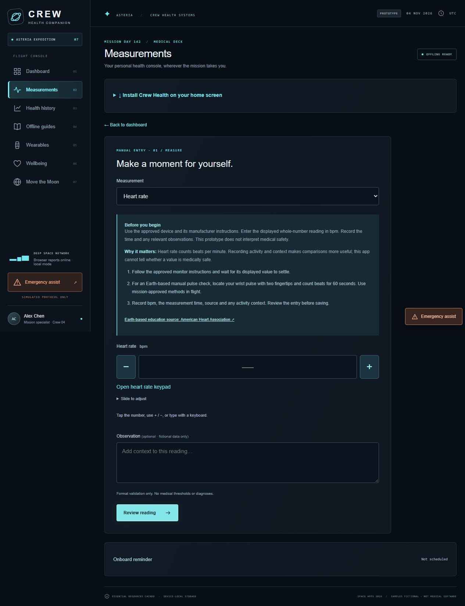

Choose **Heart rate** in the Measurement selector. Instructions explain the measurement, its **bpm** unit, and why recording context matters. Enter the displayed whole-number value with the large number control, plus/minus buttons, keypad, optional slider, or keyboard. Add an optional observation, then select **Review reading**. The source link opens external Earth-based educational material; flight-approved procedures are not supplied by this prototype.

### 3. Touch keypad — enter numbers without typing

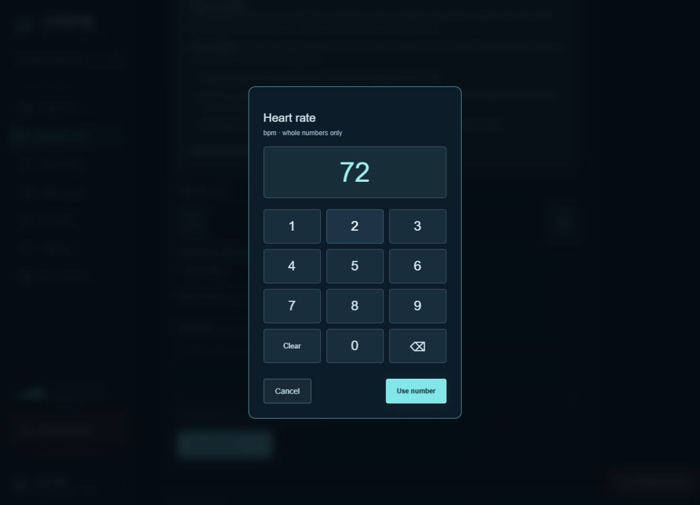

Tap a number field or its keypad button to open this dialog. Large digit buttons build the value; **Backspace** removes the last digit and **Clear** resets it. **Use number** applies the draft to the form, while **Cancel** discards that keypad edit. Keyboard controls remain available. Applying a number does not save a health record: review and explicit save still follow.

### 4. Review — confirm the value, context, and source

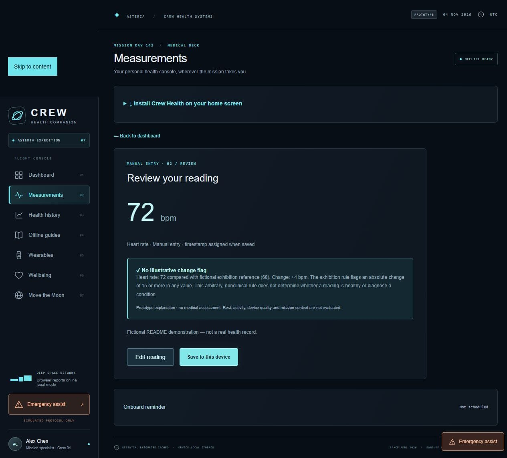

This screen shows the value and unit, whether it was entered manually or received from a sensor, the observation, and an explanation of its comparison with an earlier reading or fictional reference. **Edit reading** returns to the form; **Save to this device** commits the record locally. Manual-entry timestamps are assigned on save; sensor entries retain their receipt timestamp.

The expandable prior-entry comparison retains the earlier arbitrary exhibition change rules: an absolute change of **15 bpm** for heart rate or **20 mmHg** in either blood-pressure value triggers an illustrative flag. **These are not clinical thresholds.** No flag does not mean a reading is healthy or safe, and a flag is not a diagnosis.

The primary review and history summaries now show cited educational reference guidance and next steps; the old exhibition comparison is secondary and expandable.

### 5. Blood-pressure entry — two separate values

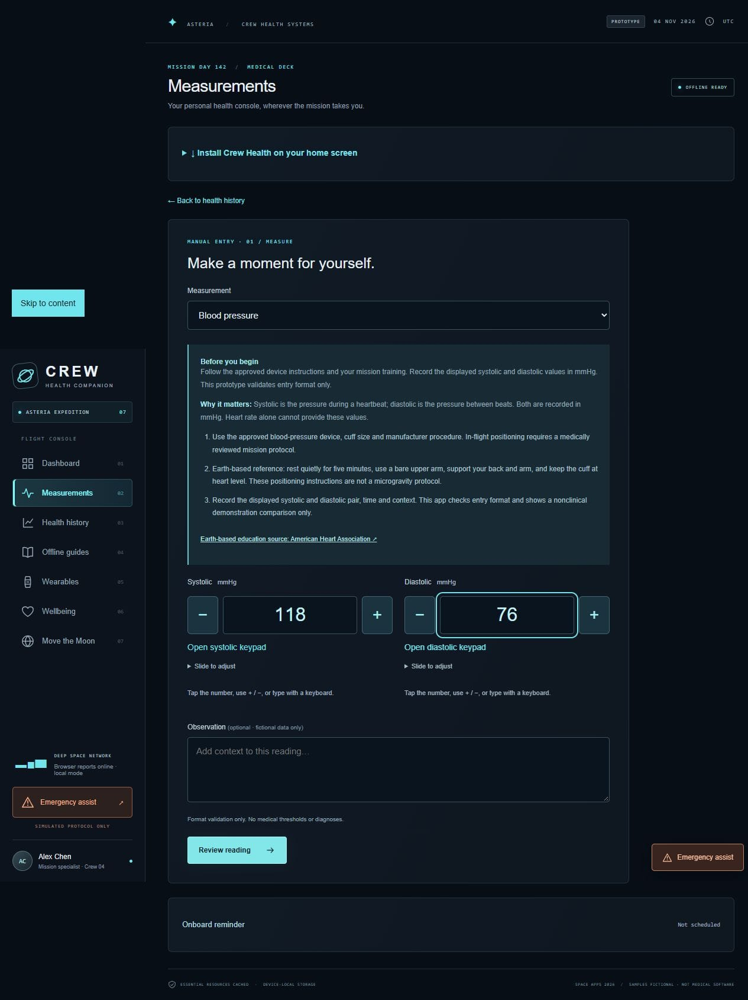

Choose **Blood pressure** to display separate **Systolic** and **Diastolic** controls, both in **mmHg**. Each supports the same touch keypad, plus/minus, slider, and keyboard options. Enter the actual monitor values, review both, and save. The instructions explain the two readings; the app never estimates blood pressure from heart rate. Leaving an unsaved draft prompts before discarding it.

### 6. Health history, trends, and reports

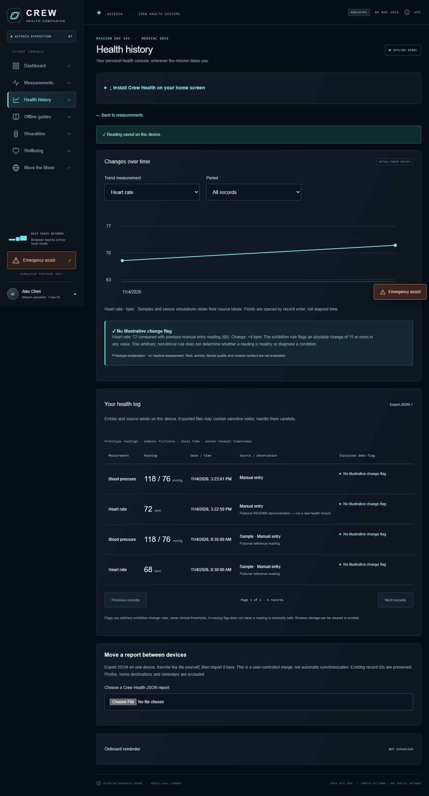

**Changes over time** lets you choose heart rate or blood pressure and filter all records, the last seven days, or the last thirty days. The chart displays the most recent 30 matching values. Tables provide exact values and timestamps, while the health log includes units, observations, device/source labels, and expandable illustrative flag explanations. Sample records are labeled; the graph can include those fictional references alongside saved entries. The main log paginates in groups of 50.

The report controls export local readings, simulation incidents, and wellbeing entries as JSON. To move a report to another device, transfer the file yourself, choose it in **Move a report between devices**, review the counts, and confirm the merge. Import validates the structure, rejects oversized files above 5 MB, and preserves existing record IDs rather than overwriting duplicates. It is not automatic synchronization. Reminders and game progress are excluded. Exported files are unencrypted and may contain sensitive notes.

### 7. Offline guides — the bundled library

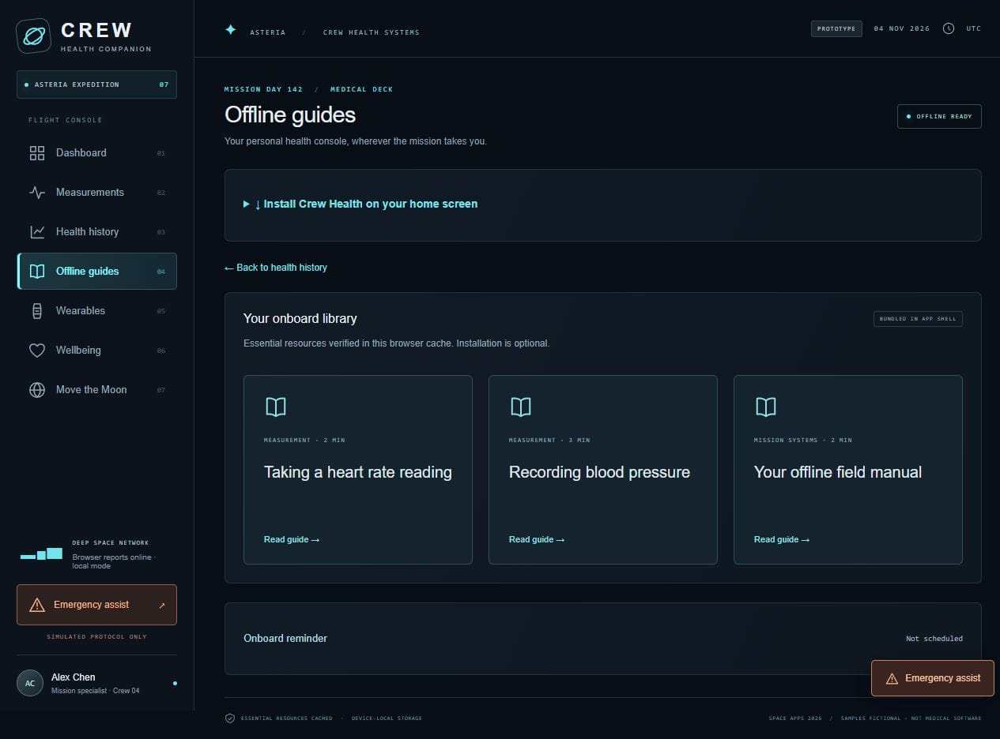

The library has three core guides, plus expandable glucose and temperature instructions, available after the app is cached:

- **Taking a heart rate reading:** what bpm means, measurement context, and recording a displayed value.
- **Recording blood pressure:** systolic/diastolic values, mmHg, and using the approved measurement device.
- **Your offline field manual:** local storage, offline preparation, and prototype limits.

The estimated reading times help people choose a short task. These are bundled app content, not documents downloaded on every visit.

### 8. Expanded guide — instructions and explanation

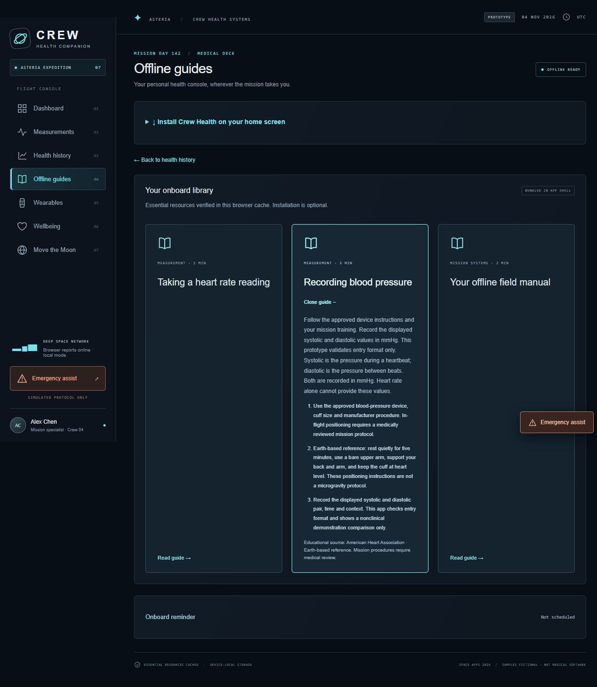

Selecting a guide expands its explanation, why the information matters, and numbered steps. Select it again to close it. Core guide text remains available offline; external source links need connectivity. Measurement education is not a replacement for an approved mission protocol or individualized medical advice.

### 9. Wearables — standard BLE connections and a labeled simulator

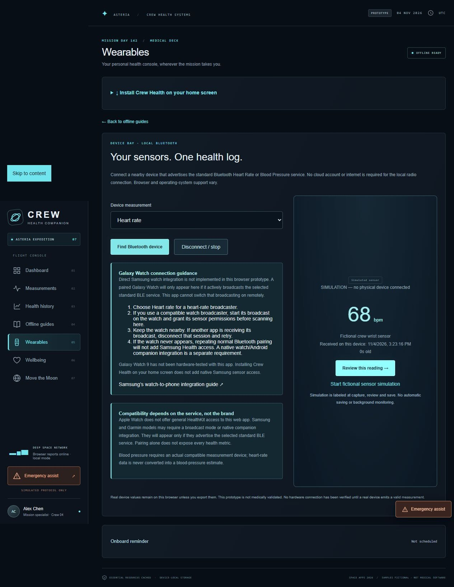

Choose **Heart rate** or **Blood pressure**, then **Find Bluetooth device** to open the browser’s device picker. The sensor must actively advertise the corresponding standard Bluetooth service. The live panel displays a received value, its age, source, and connection state. Review a reading before saving; values are not automatically written to the journal. **Disconnect / stop** ends the sensor or simulator session. Standard kPa blood-pressure packets are converted to rounded mmHg.

The screenshot shows **SIMULATION**, generated by **Start fictional sensor simulation**. That option exercises the app without hardware and stays labeled through review and history. It does not demonstrate a successful physical connection.

**Samsung Galaxy Watch 9 is not natively integrated or hardware-verified.** An empty scan can mean the watch is not broadcasting the required service. Ordinary phone pairing does not expose Samsung Health data to this website. Apple HealthKit and proprietary watch integrations require separate native work; installing the app on a home screen does not add those capabilities. Compatible BLE broadcasts, browser support, permissions, and an actual valid measurement are required. There is no universal “all watches” connection.

### 10. Wellbeing — sleep, mood, and body-area notes

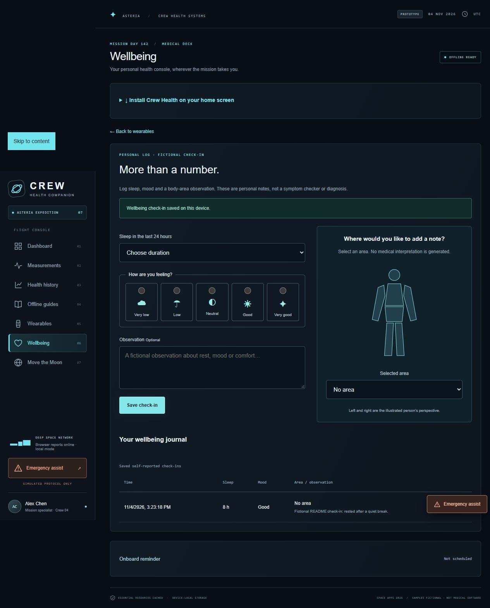

Choose sleep duration in half-hour increments, select a mood from **Very low** to **Very good**, and optionally add an observation. The body illustration and equivalent dropdown select an area for the note; left/right follow the illustrated person’s perspective. **Save check-in** writes the entry to the local journal below, which lists timestamp, sleep, mood, area, and observation. This is a personal log, not a symptom checker or medical interpretation.

### 11. Emergency assist — explicit training warning

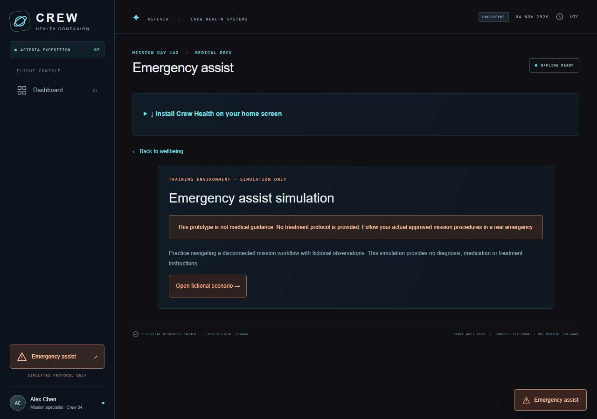

The emergency entry switches to an amber training layout. **Open fictional scenario** now opens the guided emergency rehearsal shown in screenshot 22, replacing the earlier placeholder. It provides educational response priorities and no diagnosis or medication dosing. No emergency call or medical message is sent.

### 12. Emergency observations — document a fictional scenario

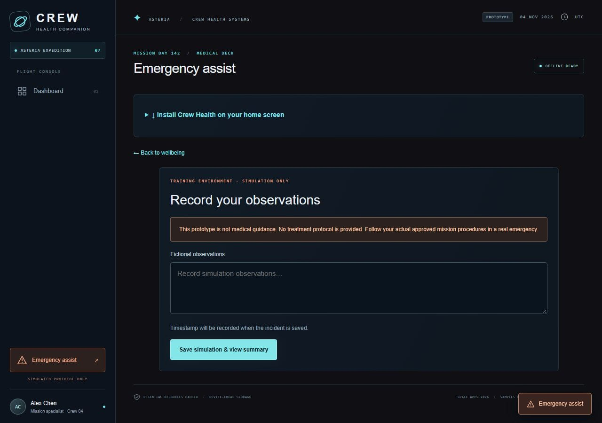

After the guided rehearsal, **Continue to observation log** opens a free-text area for fictional observations. **Save simulation & view summary** records the incident and its timestamp on this device. It does not evaluate the text, recommend care, or send an alert. Unsaved observations remain a draft until confirmed.

### 13. Emergency summary — inspect the saved incident

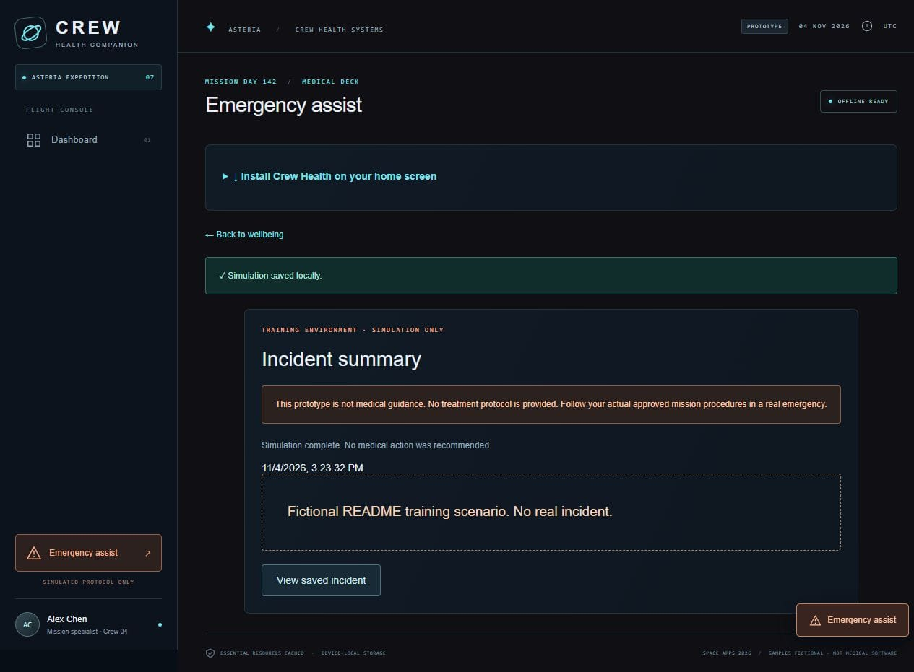

The summary confirms local persistence and shows the timestamp and notes. **View saved incident** opens the saved history. Simulation incidents are also included in JSON reports. The screenshot explicitly describes a fictional training scenario; there was no real medical incident.

### 14. Installation — add Crew Health to the home screen

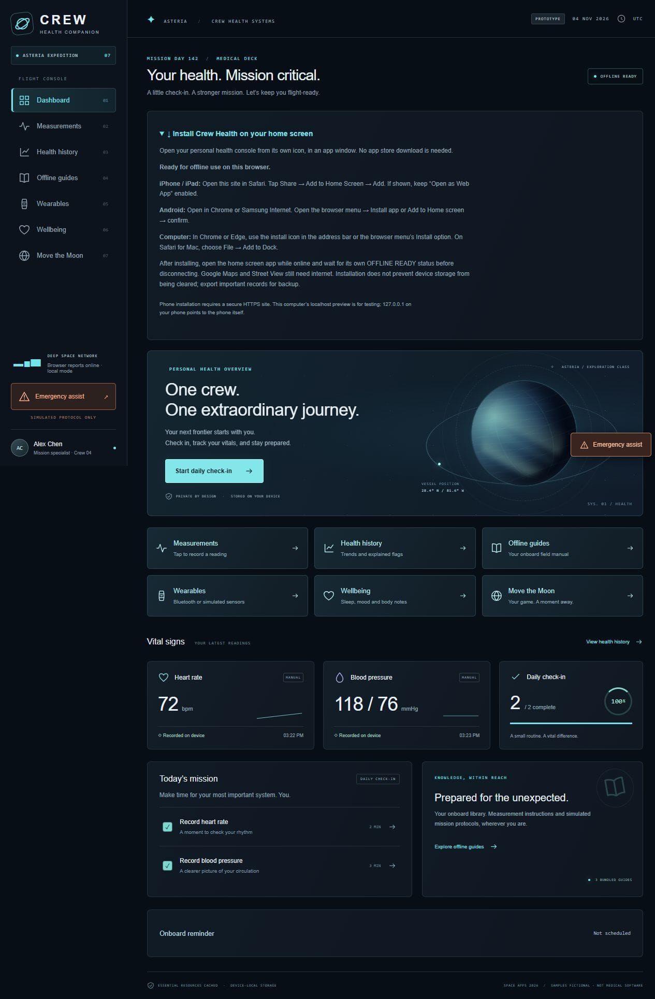

Expand **Install Crew Health on your home screen** near the top of a screen. A direct **Install app** button appears when the browser supplies an install prompt; otherwise, device instructions explain the menu flow:

- **iPhone/iPad:** open in Safari → Share → Add to Home Screen → Add. Keep Open as Web App enabled if offered.
- **Android:** open in Chrome or Samsung Internet → browser menu → Install app / Add to Home screen.
- **Desktop:** use Chrome/Edge’s install option, or Safari on Mac → File → Add to Dock.

Menu wording and availability vary. Open the installed app online and wait for its own **OFFLINE READY** status before disconnecting. The install icon creates a standalone launch experience; it does not guarantee permanent storage, background alarms, or watch compatibility.

A phone needs a reachable **HTTPS** address for the intended installation workflow. `127.0.0.1` on the phone refers to the phone itself, not this PC. This repository does not automatically deploy a site. Native installation has not been tested on real iOS/Android devices.

### 15. Onboard reminder — a local foreground reminder

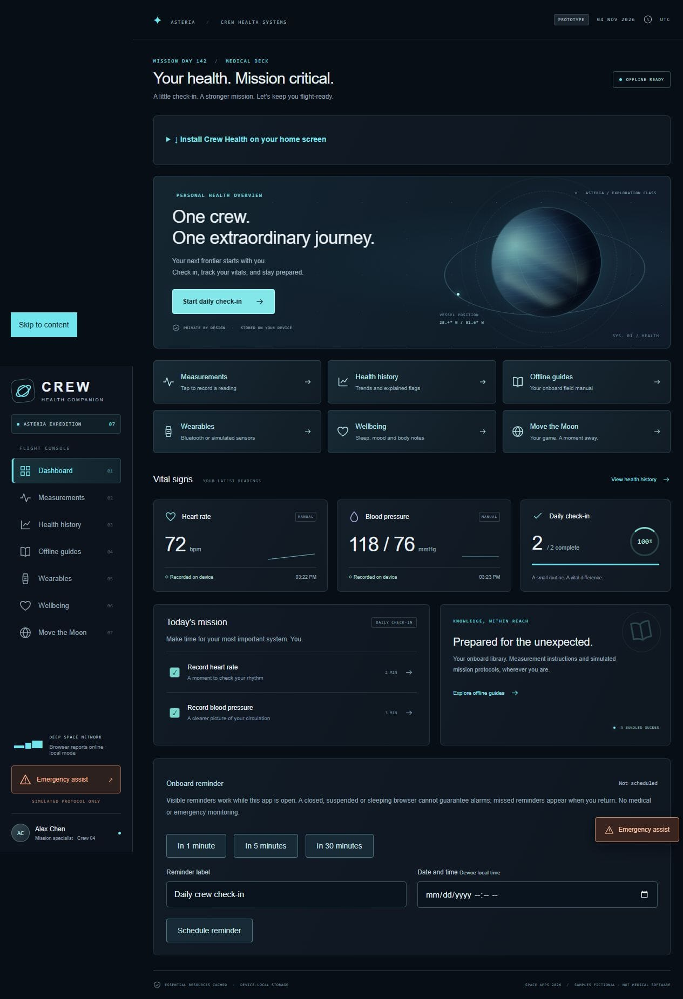

Expand **Onboard reminder** to choose a label and device-local date/time, or use the one-, five-, and thirty-minute shortcuts. The schedule persists on the device. A due reminder appears while the app is active; missed reminders can appear on return. Dismissing acknowledges it. A closed, suspended, or sleeping browser cannot guarantee an alarm, so this is not medical monitoring or an emergency notification system.

### 16. Move the Moon — David’s original game

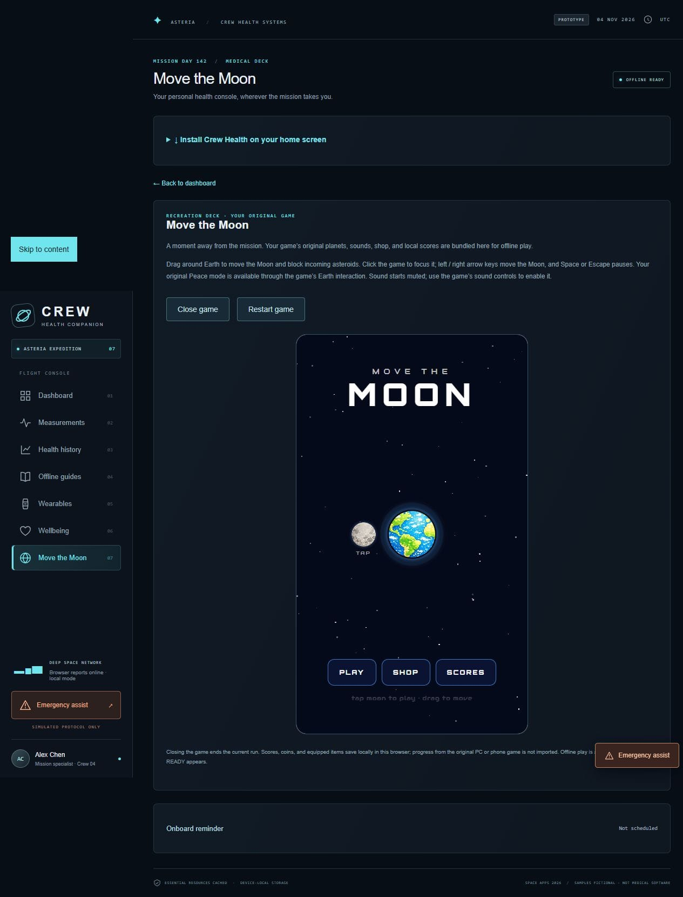

The recreation screen replaces Earth Room. **Launch Move the Moon** opens the bundled web version of David’s original Desktop Expo game, including its planets, fonts, sounds, original gameplay, shop, and local scores. The original PC project is untouched. **Close game** ends the current run; **Restart game** asks before reloading the game. Native app progress is not imported into this web copy.

The menu offers **PLAY**, **SHOP**, and **SCORES**. Long-press Earth on the menu to enter the original **Peace mode**, which disables normal asteroid gameplay for a quieter interaction. Sound starts muted and can be enabled from the game controls. Native rewarded ads and their reward buttons are disabled; there are no ad requests or simulated ad rewards.

### 17. Game shop — planets, backgrounds, and sounds

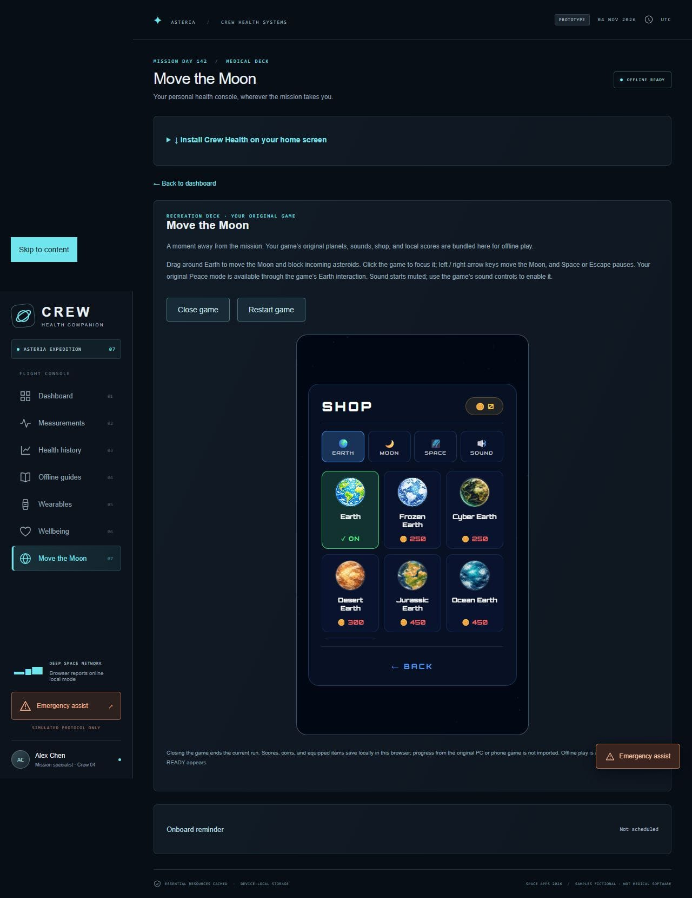

The shop has **EARTH**, **MOON**, **SPACE**, and **SOUND** categories. The coin count shows the local game balance; items display their in-game coin cost or equipped state. Select owned items to change the game’s appearance or sound. Coins are game currency, not a checkout or real-money purchase. Owned items, balance, and equipped choices save in this browser. They are not part of health exports and do not sync with the standalone game.

### 18. Game scores — local results

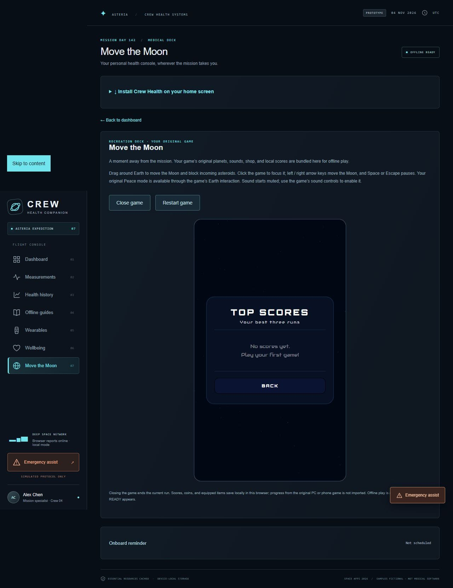

**SCORES** displays the game’s saved runs on this browser. A new preview shows an empty-state message until a run is recorded. **BACK** returns to the menu. This is a local score list, not a worldwide leaderboard or online account. Clearing site storage can erase it.

### 19. Gameplay — orbit Earth and block asteroids

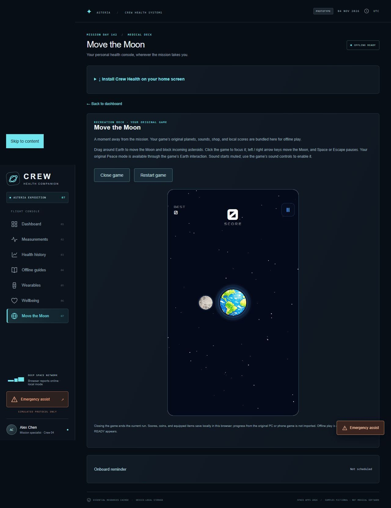

Drag around Earth to move the Moon and intercept incoming asteroids. The HUD displays the current score, best score, and pause control. With the game focused, **Left/Right arrows** move the Moon and **Space/Escape** toggles pause. The web adaptation prevents browser text selection and native image dragging inside the game so an orbit gesture does not highlight everything. Normal Crew Health text outside the game remains selectable.

### 20. Pause — sound controls and a break

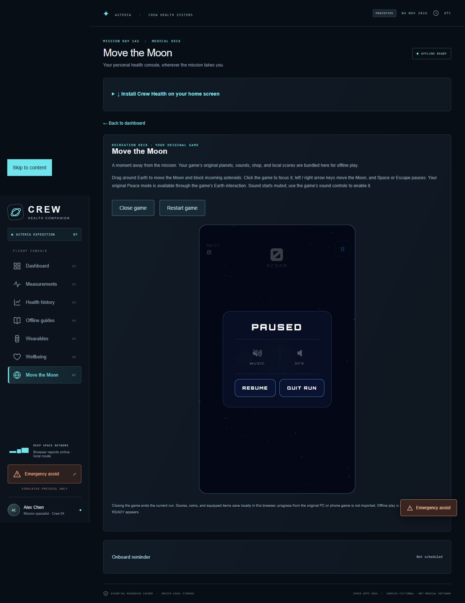

The pause overlay stops the run and exposes separate **MUSIC** and **SFX** controls. **RESUME** continues; **QUIT RUN** opens the original quit flow, which can ask before discarding unbanked progress. Switching away from the game’s document pauses active play, while leaving Crew Health’s recreation screen destroys the iframe and ends that session. Closing or restarting is different from pausing.

## Expanded challenge workflows

### 21. Mission Health — assess, act, and follow up

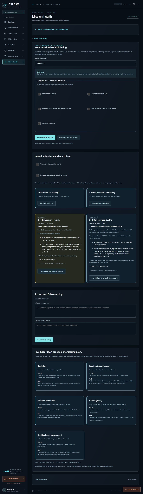

Choose the mission environment, report urgent symptoms, and inspect the latest personal indicators. Fictional starter samples are excluded and sensor simulations are excluded unless explicitly enabled for training. Missing readings remain unknown; older readings show their age. Cards combine source/timestamp, previous personal value, an educational reference category, why it matters, and concrete next steps. Urgent symptoms override numbers. Follow-up actions and outcomes save in the incident/action journal. A medical handoff text file can be downloaded for manual transfer; the app does not send it.

Spacecraft, station, rover, Moon/Mars base and Earth-training modes show different operational cautions. The five hazard cards explain what can be tracked and what actions belong to an approved mission plan. Source links identify NASA, AHA, CDC and MedlinePlus references; these are Earth references and not flight validation.

### 22. Guided emergency rehearsal — response branches and checklist

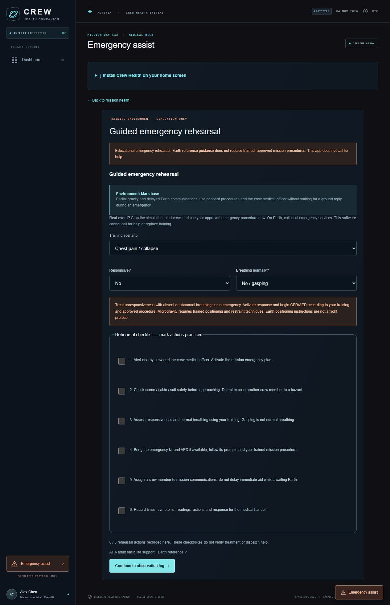

The previous placeholder is replaced with scenarios for chest pain/collapse, low glucose/altered awareness, fever/illness and habitat alarms. Responsiveness and breathing selections expose urgent response priorities. The rehearsal checklist covers crew/medical-officer alerting, scene safety, trained CPR/AED response, communications and time/action documentation. Selections populate the editable observation log before saving. Earth CPR positioning is not presented as a microgravity procedure. No completed checkbox proves treatment occurred.

### 23. Daily routine and informative body regions

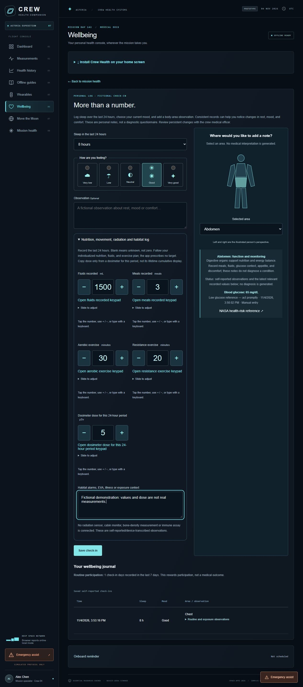

Wellbeing now also records fluids, meals, aerobic and resistance exercise, a dosimeter-transcribed dose for the stated 24-hour period, and habitat/EVA/illness notes. Blank fields mean unknown. Numeric bounds are format limits, not recommended targets. Follow individualized mission nutrition/exercise plans. Region selection explains function and monitoring, with relevant recorded readings where available. Seven-day participation counts logging days; repeated low mood prompts a crew medical check-in, not a diagnosis. Routine data is included in JSON report transfer.

### 24. Glucose and temperature — complete measurement workflows

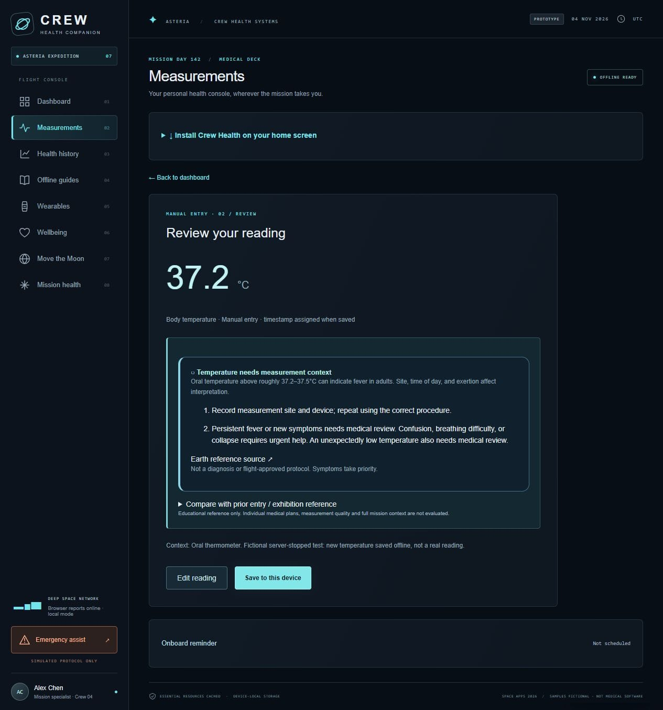

Measurements now supports **Blood glucose (mg/dL)** and **Body temperature (°C)** in addition to HR/BP. Temperature has a decimal touch-keypad button and 0.1°C stepper. A context selector captures meal timing, temperature site, or activity as part of the saved note. New readings support review, explicit save, history, charts, export/import and offline persistence. Glucose meter, thermometer and contamination-control instructions explain how/why to measure. No CGM, thermometer or lab integration is implied.

## How offline mode works

The first connected production visit installs `public/sw.js`. It caches the application HTML, referenced Next.js scripts/styles, manifest, app icons, and every required exported game asset. It writes a resource inventory after successful preload. `lib/offline.ts` checks that inventory on load, service-worker changes, and tab resume. The app also checks local database availability before showing **OFFLINE READY**.

| Capability | Offline behaviour |
| --- | --- |
| Manual readings, review, local history and trends | Available after the app is cached. |
| Guides and emergency simulation | Bundled content; no operational treatment protocol is supplied. |
| Wellbeing journal and foreground reminders | Local; browser suspension still limits reminder delivery. |
| Move the Moon, artwork, fonts, sounds and local saves | Bundled; wait for the complete game preload. |
| JSON export/import | Local file workflow; moving a report between devices is manual. |
| Compatible standard BLE sensor | Local radio can work without internet; hardware/browser support is still required. |
| External education or documentation links | Require a network connection to load uncached destinations. |
| Initial dependency install, first preload, and receiving updates | Require connectivity. |

Browser storage can be cleared, denied, run out of space, or be evicted. Installation does not remove those limits. Export important records yourself; game progress is not included in health reports. Data does not follow you automatically to another browser, port, device, or installed environment.

The current cache version is **`crew-health-v16`**. When shipping changed files, bump the worker cache version, rebuild, reconnect, and reload so the new version preloads. A reload may first show the previous cached version while the worker updates. A disconnected device cannot receive a new release.

## Project structure

| Location | Responsibility |
| --- | --- |
| `app/page.tsx` | Main console, view navigation, reading workflow, history, and emergency simulation. |
| `app/globals.css` | Space-console styling, responsive layouts, motion and focus presentation. |
| `app/components/` | Number controls, trends, wearables, wellbeing, reminders, installation, transfer, and game wrapper. |
| `lib/storage.ts` | IndexedDB schema 2: readings, incidents, wellness, preferences, and resources. Version-1 data migrates in place. |
| `lib/insights.ts` | Transparent, nonclinical exhibition comparison rules. |
| `lib/health.ts` | Indicator instructions, source-linked reference assessments, environment profiles and hazard monitoring guidance. |
| `lib/bluetooth.ts` | Standard heart-rate and blood-pressure packet parsing. |
| `lib/transfer.ts` | JSON report validation and atomic import/merge. |
| `lib/content.ts` | Fictional references and guide content. |
| `lib/offline.ts`, `public/sw.js` | Offline monitoring, complete resource preload, and cached document handling. |
| `public/manifest.webmanifest`, `public/icon-*.png` | Standalone installation metadata and app icons. |
| `public/games/move-the-moon/` | Ready-to-run exported web game and assets. |
| `vendor/move-the-moon/` | Copied Expo source and web adaptations, separate from the original Desktop project. |
| `docs/screenshots/` | The 24 real application screenshots used in this README. |
| `tests/` | Node test runner checks for storage, sensors, transfer, flags, and offline behaviour. |

Core views switch locally without cloud APIs or server actions. Health records use IndexedDB; game progress uses the game’s web AsyncStorage/localStorage. Neither is a mission-grade encrypted record system. Legacy Earth Room source and packages remain dormant for possible later work, but its maps, nature scenes, breathing screen, and constellation game are not current app features.

For rebuilding the Expo game, web adaptations, and offline asset inventory details, see [Move the Moon integration](docs/MOVE_THE_MOON.md). For the original requirements and historical implementation notes, see [REQUIREMENTS.md](REQUIREMENTS.md); the current interface described here supersedes its archived Earth Room entries.

## Verification and remaining limits

See [CHALLENGE_ALIGNMENT.md](docs/CHALLENGE_ALIGNMENT.md) for the current full-brief audit and source register. Older screenshots 1–20 illustrate earlier screens; 21–24 show the expanded workflows.


The current 24 automated tests cover input formats, database persistence and write failures, schema migration, report validation/merge, BLE packet parsing, illustrative flags, cached navigation, separate cached game navigation, and incomplete-cache readiness. Build and lint have also passed. Browser checks additionally verified decimal temperature entry, glucose saving and trends, source-linked assessment, persisted Mars environment, emergency checklist-to-notes transfer, saved follow-ups, extended routine records, and complete medical handoff downloads. A new temperature was saved and retained after refresh with the preview server stopped. The updated Mission Health layout was checked at 390px with no page overflow.

Browser checks cover manual entry/review/save, demo sensor labels, wellbeing saves, guide expansion, emergency simulation, game launch/shop/gameplay/pause, and the no-selection drag fix. Screenshots above were captured from a separate local production preview using fictional data.

A server-stopped check confirmed that the cached application and game reopened without the local server. That does not substitute for testing physical airplane mode, storage exhaustion, every target browser, or real phone installation. Physical BLE hardware, Samsung Watch 9, native watch SDK integrations, full screen-reader compliance, and flight conditions remain unverified. Cited educational assessment and response guidance are implemented; validated clinical diagnosis, flight-approved treatment, worldwide live cameras, automatic cloud synchronization and real emergency dispatch are not.

### Repeatable offline check

1. Build and start production, open a fresh browser profile/origin, and wait for **OFFLINE READY**.
2. Enter a clearly fictional reading, review/save it, and refresh to confirm persistence.
3. Disconnect the actual device network, leave the service worker enabled, and reload.
4. Open every main screen; enter another fictional reading, save a wellbeing check-in, and run a fictional emergency scenario.
5. Launch Move the Moon, open its shop, play, pause, and check that its artwork and controls still work.
6. Refresh again and verify that saved records remain. Test report transfer separately in another disposable profile.
7. Restore connectivity before updating. For a deliberate missing-resource test, use a disposable profile, remove a required cache file in DevTools, and confirm readiness clears.

### Privacy

No user account or automatic health-data upload is part of the app. Explicitly connected real sensors can supply real values; those stay in the browser unless exported. Reports are unencrypted and may contain sensitive observations. External links receive ordinary browser request information when opened; the app does not attach health records to them. Use fictional records when demonstrating or taking screenshots.
